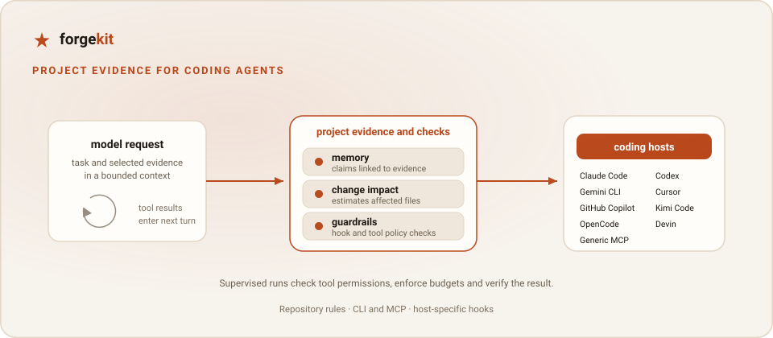
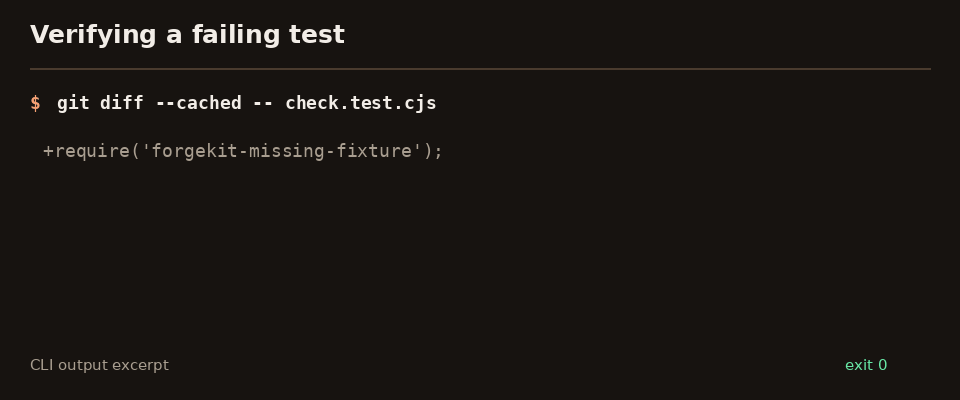
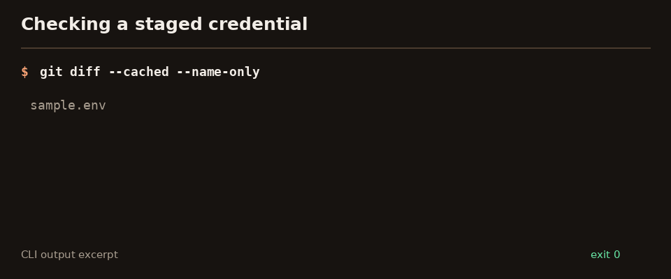
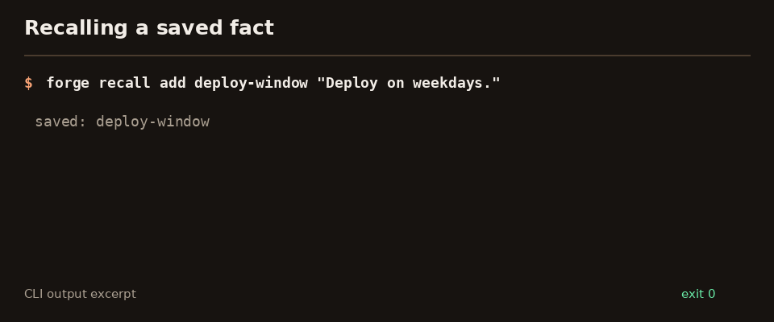

# ForgeKit: the safety and verification layer for AI coding agents

[](https://github.com/CodeWithJuber/forgekit/actions/workflows/ci.yml)
[](https://github.com/CodeWithJuber/forgekit/actions/workflows/codeql.yml)
[](https://scorecard.dev/viewer/?uri=github.com/CodeWithJuber/forgekit)
[](./LICENSE)
[](./package.json)
[](./package.json)

<p align="center">
  <picture>
    <source media="(prefers-color-scheme: dark)" srcset="docs/assets/hero-dark.svg">
    
  </picture>
</p>

ForgeKit works around the coding agents you already use: Claude Code, Codex, Cursor, Gemini CLI,
Copilot, Kimi Code, OpenCode, Zed and more. It stops an invented package or a leaked secret before it
lands, keeps what your team learns in the repository so every agent sees it, and runs your real
tests before anyone calls a change done. One Node CLI, zero runtime dependencies, plain files in
git, MIT licensed.

## 60-second quickstart

See it work first. The demo makes its own throwaway project, so it changes nothing of yours:

```bash
npm install -g @codewithjuber/forgekit
forge demo     # a test passes, a one-line change breaks it, forge verify catches it, the fix passes
```

Then turn it on in your repository:

```bash
forge init             # set up the agents this repo uses, from one shared rulebook
forge doctor           # check hooks, providers and MCP wiring (--fix repairs)
forge impact <symbol>  # which files will this edit probably touch?
forge verify           # run the tests on this exact tree: PASS, FAIL or INCOMPLETE
```

On Claude Code you can install the plugin instead:
`/plugin install forgekit --marketplace CodeWithJuber/forgekit`. Every install path, and what
`forge init` changes on your machine, is in [Setup details](docs/OVERVIEW.md#setup-details).

## What it catches

- **A package that does not exist.** Agents invent dependency names, and attackers register
  them (slopsquatting). The dep-gate hook checks install commands and manifest edits in nine
  ecosystems and blocks a name that is not on its registry or that OSV lists as malicious.
  `forge vet <name>` runs the same check by hand.
- **A secret in a commit.** `forge precommit` refuses a staged change with a credential-shaped
  value, and a redaction hook scrubs secrets from tool output.
- **An MCP server that quietly changes its tools.** `forge sources probe <id>` pins a SHA-256
  digest of a server's tool list and fails when the surface changes, a direct check against
  tool poisoning and rug-pull updates.
- **"Done" with no passing tests.** `forge verify` runs the suites your repository already has
  and binds the verdict to the exact tree it ran on. On Claude Code a completion gate stops a
  session that moved code without test evidence.
- **The bug the agent fixed last month and brought back.** `forge remember` and the ledger keep
  lessons in the repository, with references to their evidence, and teammates get them by
  pulling.
- **The rename that broke files nobody opened.** `forge impact <symbol>` lists the files an edit
  will probably touch, including coupled ones you did not name. It is a heuristic, so an empty
  answer means "unknown", not "safe".

These checks run as hooks, not as text in a prompt, so they still apply after a context
compaction. `forge hooks on` writes the same wiring into the repository for Claude Code, Codex,
Gemini CLI, Cursor and Copilot, so a teammate's agent and CI run them too.

ForgeKit does not ask you to replace the rest of your setup. Keep your workflow skills, your
code-intelligence server and your task tracker: the checks above run on the agent's own tool
calls and commits, whichever of those you use.

## See it in action



A missing module breaks the project's npm test. `forge verify` runs that test and reports a failed verdict.



`forge precommit` checks the staged diff and refuses the synthetic credential.



`forge recall add` saves a fact. A separate invocation of `forge recall list` retrieves it.

## Start here: eight commands

These are what `forge --help` shows first. The other commands are still there:
`forge --help --all` lists every one, and [the full table](#all-commands) is below.

<!-- forge:render:start-here:begin (generated by `forge docs render` — do not edit) -->
| Command           | What it does                                                      |
| ----------------- | ----------------------------------------------------------------- |
| `forge init`      | set up ForgeKit for the coding agents this repo uses              |
| `forge doctor`    | check that hooks, providers and MCP wiring work (--fix repairs)   |
| `forge sync`      | rewrite every agent's config after you edit the shared rules      |
| `forge remember`  | save a fact for every agent (run sync to deliver it)              |
| `forge impact`    | list the files an edit to a symbol will probably touch            |
| `forge verify`    | run the repo's tests and report PASS, FAIL or INCOMPLETE          |
| `forge precommit` | stop a commit that leaks a secret or changes code without docs    |
| `forge vet`       | check a package is real and not known malicious before installing |
<!-- forge:render:start-here:end -->

## Works with

| Tool | Native config | MCP server entry | Automatic hooks |
|---|---|---|---|
| Claude Code | ✅ | ✅ | Plugin or project hooks |
| Local Codex | ✅ | ✅ | Trusted plugin or project hooks |
| Cursor, Gemini CLI, Copilot | ✅ | ✅ | Project hooks |
| Zed, Continue | ✅ | ✅ | — |
| Windsurf / Devin | ✅ | — | Devin can use trusted Claude project hooks |
| Kimi Code | ✅ | Project MCP | Native user plugin |
| OpenCode | ✅ | Project MCP | Generated JavaScript plugin |
| Aider | ✅ | — | — |
| OpenClaw | ✅ | Operator registration or bundle | — |
| Roo Code, VS Code | — | ✅ | — |

Claude Code has the deepest real-world testing. What each integration does, and how it is
tested, is in [docs/INTEGRATIONS.md](docs/INTEGRATIONS.md).

## How it works

ForgeKit checks a task before the agent acts, lets the agent work, and records evidence from
tests, CI or a person afterwards. Only those independent checks raise a lesson's confidence,
so a wrong lesson fades instead of hardening into a rule.

[](https://jubershaikh.com/forgekit/diagrams/core-loop.html)

<sub>[Open the interactive diagram](https://jubershaikh.com/forgekit/diagrams/core-loop.html): pan, zoom, search, and trace any node.</sub>

Every agent also gets a short working method in `AGENTS.md`: check the goal and the means, act
on evidence, change one thing at a time, prove the result, fix without breaking anyone. Longer
protocols for debugging, research, building and security fixes ship as skills, and the prompt
hook names the right one for the task. [The working method](docs/GUIDE.md#the-working-method--how-any-agent-works-through-a-problem)

For a task that needs approval gates, spending limits and a signed verification result, use
the [supervised harness](docs/HARNESS.md).

## Measured, with limits

Every number comes from `npm run bench` on this repository and is recorded with its
environment in [reports/benchmarks.md](reports/benchmarks.md).

- **A full pre-action gate in 851 ms** on a warm graph with no model call (one repository, a
  4-core Linux VM).
- **Blast radius in 1.68 ms** for a warm impact query. On six hand-labelled cases recall is
  1.00 and precision 0.17.
- **20.2% more cost than always-premium**. The white paper's 62.1% routing saving did not hold
  on 80 held-out tasks, so the project publishes it as refuted.

Refutations, boundaries and the research prototypes are in [docs/EVIDENCE.md](docs/EVIDENCE.md).

## Honest limits

- **Beta.** Releases follow Semantic Versioning, and support is best effort with no SLA. What is
  stable today, the deprecation policy and the criteria for dropping the label are in
  [docs/STABILITY.md](docs/STABILITY.md).
- **Impact is heuristic.** A regex-derived code graph, not a sound call graph: it can miss
  files and over-warn.
- **Guardrails are defence in depth, not a sandbox.** Commands are normalized the way the shell
  reads them (quotes, variables, substitutions, inline programs) before they are judged. It is
  static analysis: a program the guard cannot evaluate can still get past it.
- **Memory is external state.** Facts live in files and are retrieved into context; no model is
  retrained.

The full list is in [docs/OVERVIEW.md](docs/OVERVIEW.md#honest-limits).

## Teams

The ledger merges over plain git: `forge ledger sync` keeps it under `refs/forge/ledger`, and two
teammates' copies converge whoever syncs first. `forge cloud` and `forge relay` sync encrypted
workspace evidence through a receiver you run, which stores only ciphertext.
[Team memory](docs/OVERVIEW.md#team-memory)

## All commands

<details>
<summary>Every command, grouped as in <code>forge --help --all</code></summary>

<!-- forge:render:commands-table:begin (generated by `forge docs render` — do not edit) -->
| Group         | Command               | Does                                                                                                                                                                                                                                                                                                                                                                      |
| ------------- | --------------------- | ------------------------------------------------------------------------------------------------------------------------------------------------------------------------------------------------------------------------------------------------------------------------------------------------------------------------------------------------------------------------- |
| **Core**      | `forge init`          | scaffold this repo's config — emits the tools it uses (detected hosts, or --tools) from one shared source                                                                                                                                                                                                                                                                 |
|               | `forge sync`          | recompile the canonical source into each tool's native config files                                                                                                                                                                                                                                                                                                       |
|               | `forge doctor`        | health-check installed tools, guards, MCP auth, and config drift                                                                                                                                                                                                                                                                                                          |
|               | `forge tools`         | primary-tool config — gitignore secondary-tool artifacts (.cursor/.gemini/…) for tools this repo doesn't use (`forge tools <name>` sets it, `--reset` clears)                                                                                                                                                                                                             |
|               | `forge catalog`       | Start Here — list every tool, crew, and guard with a one-line why                                                                                                                                                                                                                                                                                                         |
|               | `forge docs`          | docs↔code drift — check (registry reconcile) / render (regenerate machine-owned tables + diagrams) / sync (diff-driven stale-docs sweep) / impact (reusable doc-reference graph: which docs mention what THIS diff changed)                                                                                                                                               |
|               | `forge update`        | self-update — `--check` reports if a newer version is available, bare applies it, `--to <version>` pins/downgrades                                                                                                                                                                                                                                                        |
|               | `forge config`        | provider setup — show / switch / add providers, set default model                                                                                                                                                                                                                                                                                                         |
|               | `forge dash`          | open a local project dashboard to inspect runs, check agent setup and review project memory                                                                                                                                                                                                                                                                               |
|               | `forge report`        | emit a static, self-contained HTML snapshot of .forge/ — opens offline, no server, no script                                                                                                                                                                                                                                                                              |
| **Substrate** | `forge substrate`     | one pre-action gate: assumptions, route, impact, scope, memory, verify                                                                                                                                                                                                                                                                                                    |
|               | `forge preflight`     | assumption check — what a task names that the repo doesn't define                                                                                                                                                                                                                                                                                                         |
|               | `forge evidence`      | find existing code, cached source excerpts and public research candidates before editing or debugging                                                                                                                                                                                                                                                                     |
|               | `forge team`          | plan independent read-only agents for complex work and optionally run them with a shared budget                                                                                                                                                                                                                                                                           |
|               | `forge develop`       | assemble a development plan, search prior solutions, assess security and select verification for the current change                                                                                                                                                                                                                                                       |
|               | `forge sources`       | sync scoped project sources privately and search, route live reads or aggregate local tables                                                                                                                                                                                                                                                                              |
|               | `forge impact`        | hazard-aware blast radius — SCC-aware propagation + data-driven threshold from PageRank centrality and ledger incident history                                                                                                                                                                                                                                            |
|               | `forge scope`         | decompose files into independent clusters (+ coupled files you didn't name)                                                                                                                                                                                                                                                                                               |
|               | `forge context`       | budgeted context assembly + completeness gate — what an edit NEEDS known, delivered or owed                                                                                                                                                                                                                                                                               |
|               | `forge route`         | recommend the cheapest capable model for a task (+ gateway config); `route universal`: any provider's models, lowest expected cost for the success asked for, learned from outcomes                                                                                                                                                                                       |
|               | `forge orchestration` | agent-orchestration rule pack (no polling, parallel cap, CI for heavy checks, fresh sub-agents, model routing, risk review, isolated envs, lean lead), the working-method pack (goal and means, evidence first, isolate, proof of done, fix without breaking) and the unattended routing policy — list, switch rules on/off, set routing mode/gates, per repo or --global |
|               | `forge harness`       | run host-neutral supervised tasks with policy, budgets, verification and replayable evidence                                                                                                                                                                                                                                                                              |
|               | `forge advisor`       | Claude Code's advisor tool — a stronger second model consulted at decision points: set the advisor per repo (emitted into .claude/settings.json by sync, with an Advisor rule section in AGENTS.md) or --global, check a main/advisor pairing before Claude Code refuses it, list accepted pairings                                                                       |
|               | `forge verify`        | independent verification gate — tests + hallucinated-symbol + provenance (--deep: multi-lens consensus)                                                                                                                                                                                                                                                                   |
|               | `forge demo`          | scripted scenario — a throwaway repo goes green → broken → green while forge verify watches (the README hero, runnable)                                                                                                                                                                                                                                                   |
|               | `forge precommit`     | commit-level gate — staged code w/o docs + secret scan (FORGE_COMMIT_GATE=block|warn|0)                                                                                                                                                                                                                                                                                   |
|               | `forge test-select`   | smart test selection — the tier contract as a command: which tests this change owes (selection only, never runs them)                                                                                                                                                                                                                                                     |
|               | `forge imagine`       | consequence simulation — predicted breaks and the smallest test suite for a task, optionally run in an isolated checkout                                                                                                                                                                                                                                                  |
|               | `forge lean`          | scope-minimality check — measure the working diff's footprint against what the task asked for                                                                                                                                                                                                                                                                             |
|               | `forge anchor`        | goal-drift check — are your actual (git) changes still on the stated goal? set/show/clear keep the goal across sessions                                                                                                                                                                                                                                                   |
|               | `forge diagnose`      | doom-loop check — record a failure; the same signature three times mints a diagnosis and an escalation                                                                                                                                                                                                                                                                    |
|               | `forge collide`       | parallel-session conflict radar — who else recently touched the files (or their import neighbors) you are editing                                                                                                                                                                                                                                                         |
| **Memory**    | `forge hikmah`        | bind a local Hikmah kernel ledger and recall its verified public lessons                                                                                                                                                                                                                                                                                                  |
|               | `forge cortex`        | self-correcting project memory — status / why <symbol>                                                                                                                                                                                                                                                                                                                    |
|               | `forge recall`        | manage cross-session memory (list / add / consolidate)                                                                                                                                                                                                                                                                                                                    |
|               | `forge remember`      | add a durable fact to this repo's portable memory (forge brain)                                                                                                                                                                                                                                                                                                           |
|               | `forge brain`         | show / rebuild the portable project memory index                                                                                                                                                                                                                                                                                                                          |
|               | `forge ledger`        | evidence-referenced memory — stats / verify / show / blame / query / compact / at / diff / root / ratify / retract / merge / sync / import                                                                                                                                                                                                                                |
|               | `forge claim`         | claim interop — export the ledger's claims as open JSON any tool can read (step 1 toward claims as a standard)                                                                                                                                                                                                                                                            |
|               | `forge handoff`       | bounded session snapshot — rewrite .forge/state.md, re-injected each session start                                                                                                                                                                                                                                                                                        |
|               | `forge decide`        | append-only decision log — D-#### ADR-lite entries in .forge/decisions.md                                                                                                                                                                                                                                                                                                 |
|               | `forge know`          | route any fact to its storage home (decision / ledger / recall / …) — total, never dropped                                                                                                                                                                                                                                                                                |
|               | `forge deja`          | anti-repetition — have you done this task before? ranks prior solved and verified sessions from the ledger                                                                                                                                                                                                                                                                |
|               | `forge reuse`         | proof-carrying code cache — query a spec for verified code, mint code with its evidence, or show stats                                                                                                                                                                                                                                                                    |
| **Quality**   | `forge scan`          | vet a skill/MCP for injection/RCE/exfil before install (skill-gate)                                                                                                                                                                                                                                                                                                       |
|               | `forge vet`           | vet a package before install (dep-gate) — is the name on its registry, is it listed malicious, how new and thin is it                                                                                                                                                                                                                                                     |
|               | `forge spec`          | spec-as-contract — init (OpenSpec) / lock / check drift                                                                                                                                                                                                                                                                                                                   |
|               | `forge harden`        | wire security controls — pre-commit gate (gitleaks + commit gate) + sandbox settings                                                                                                                                                                                                                                                                                      |
|               | `forge radar`         | dependency-currency rings — staleness/major-lag/advisories from live registry evidence, cached 24h                                                                                                                                                                                                                                                                        |
|               | `forge hooks`         | run the guards by themselves in every agent — project-level hook files for Claude Code, Codex, Gemini CLI, Cursor, Copilot and OpenCode (cloud agents and CI included)                                                                                                                                                                                                    |
|               | `forge uicheck`       | deterministic UI checks — contrast <fg> <bg> · fingerprint <file...> · design <file...> · visual <file-or-url> · interact <file-or-url>                                                                                                                                                                                                                                   |
|               | `forge rank`          | load-bearing code — PageRank centrality × past-incident history, circular-dependency clusters, chokepoint files                                                                                                                                                                                                                                                           |
| **Config**    | `forge prompts`       | choose a workspace development profile or show a portable prompt and specialist role                                                                                                                                                                                                                                                                                      |
|               | `forge discover`      | find task-fit skills, plugins, tools and hooks; configure global/workspace Jev advice                                                                                                                                                                                                                                                                                     |
|               | `forge brand`         | print the active brand token map                                                                                                                                                                                                                                                                                                                                          |
|               | `forge atlas`         | build / query the code-graph (where-is-Y, has-symbol)                                                                                                                                                                                                                                                                                                                     |
|               | `forge stack`         | detect this repo's real stack (languages, frameworks, test commands) from its manifests                                                                                                                                                                                                                                                                                   |
|               | `forge integrations`  | choose project integrations, register custom packages and connect hosted or self-managed MCP endpoints                                                                                                                                                                                                                                                                    |
|               | `forge cost`          | real per-day spend via ccusage + measured stage factors (--stages)                                                                                                                                                                                                                                                                                                        |
|               | `forge budget`        | cost governance — per-day and per-task spend budgets, alert threshold, and an opt-in circuit breaker the cost guard enforces                                                                                                                                                                                                                                              |
|               | `forge models`        | each tier's model family resolved to a concrete model — newest in the provider's live catalog (else the shipped snapshot), with its price and where both came from                                                                                                                                                                                                        |
|               | `forge taste`         | pin one visual direction for this repo's UI work by writing a managed DESIGN.md (no style = list them)                                                                                                                                                                                                                                                                    |
| **Sync**      | `forge cloud`         | synchronize an enrolled workspace with its private dashboard                                                                                                                                                                                                                                                                                                              |
|               | `forge relay`         | synchronize encrypted workspace evidence through a private relay that stores only ciphertext                                                                                                                                                                                                                                                                              |
<!-- forge:render:commands-table:end -->

</details>

## Learn more

| Document | Contents |
| --- | --- |
| [docs/OVERVIEW.md](docs/OVERVIEW.md) | Status notes, setup, orchestration, advisor pairing, team memory, retrieval, MCP tools and every limit |
| [docs/GUIDE.md](docs/GUIDE.md) | Every command with worked examples and output |
| [docs/EVIDENCE.md](docs/EVIDENCE.md) | Measurements, refutations, structural comparison and the research prototypes |
| [docs/HARNESS.md](docs/HARNESS.md) | Supervised tasks, model routes, verification and approvals |
| [docs/INTEGRATIONS.md](docs/INTEGRATIONS.md) | Per-tool behaviour and how each is tested |
| [docs/CLI-CONTRACTS.md](docs/CLI-CONTRACTS.md) | Commands with strict flags and versioned JSON output |
| [ARCHITECTURE.md](ARCHITECTURE.md) | Runtime layers, emitters, state and design decisions |
| [CHANGELOG.md](CHANGELOG.md) | Changes by release |

## Community and support

- **Found a gap or a wrong answer?** [Open an issue](https://github.com/CodeWithJuber/forgekit/issues). The project's rule is that a number is an assumption until it is measured.
- **Get help:** [SUPPORT.md](./SUPPORT.md) and [Discussions](https://github.com/CodeWithJuber/forgekit/discussions)
- **Contribute:** [CONTRIBUTING.md](./CONTRIBUTING.md) and [Code of Conduct](./CODE_OF_CONDUCT.md)
- **Direction:** [ROADMAP.md](./ROADMAP.md) and [GOVERNANCE.md](./GOVERNANCE.md)
- **Security:** [SECURITY.md](./SECURITY.md) for private vulnerability reporting
- **Accessibility:** [ACCESSIBILITY.md](./ACCESSIBILITY.md)

---

MIT licensed. Built by [CodeWithJuber](https://github.com/CodeWithJuber).
